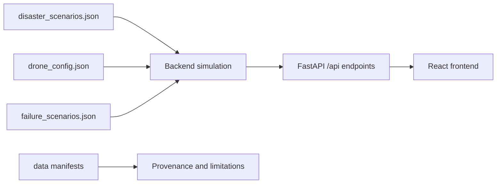

# RESQNET — Integrated Simulation and Scenario Suite

**Contract version:** 1.0 · **Data files version:** 2.0

> Simulation-based, resilient multi-agent drone coordination for disaster response.
> All scenario and configuration data in this repository is **synthetic**. Every value is an initial test parameter, not a claimed real-world operating specification.

---

## 1. About RESQNET

RESQNET (Resilient Drone Coordination for Disaster Response) is a browser-based simulation that asks one question: **how should a small drone fleet coordinate a search when the network or the central controller fails?**

The product goal is to compare how a small drone fleet coordinates search under network or controller failures. The current application launches deterministic missions on the scenario maps; failure injection and active coordination-strategy comparison are not implemented yet.

| Strategy | Idea | Weak point it is tested against |
|---|---|---|
| **Centralized** | One controller assigns all search tasks | Controller or link failure |
| **Decentralized** | Drones claim tasks locally | Duplicate or stale claims |
| **Hybrid** | Central planning while connected, local claiming and reconciliation when not | Recovery and reconnection logic |

The integrated repository includes a React/Vite frontend and a FastAPI backend. The backend runs the deterministic, tick-based simulation and keeps simulation runs in memory. SQLAlchemy provides PostgreSQL health checks and initial scenario/run tables. The computer-vision and priority-model sections below retain the data contract and roadmap; those optional components are not included in the current application.

The root-level scenario JSON files and provenance manifests from the original destination `main` are retained alongside the application components.

---

## 2. Integrated repository layout and retained data

| Path | Role |
|---|---|
| `backend/` | FastAPI API, simulation engine, SQLAlchemy database/models, dependencies, and tests |
| `frontend/` | React/Vite application, production build configuration, and Vercel SPA rewrite |
| `disaster_scenarios.json` | Three shared synthetic disaster maps and search scenarios |
| `drone_config.json` | Synthetic drone types, fleets, movement and battery parameters |
| `failure_scenarios.json` | Synthetic failure schedules and test matrix consumed by the simulation |
| `data_manifest.csv`, `data_manifest_dictionary.csv` | Destination provenance records retained from the original `main` history |

The priority-data CSVs, dictionary, and generator documented in sections 4.4, 4.5 and 4.7 are not present in the integrated tree; those sections preserve the original data-contract design only.



---

## 3. Shared conventions (the data contract)

Every component uses the same conventions. Do not invent incompatible variants.

| Item | Convention |
|---|---|
| Grid | 20 × 20 cells, 25 m per cell |
| Coordinates | Origin top-left. `x` = column 0–19 (left to right), `y` = row 0–19 (top to bottom) |
| Cell label | Column letter A–T + row number 1–20, so `x=1, y=3` is `B4` |
| Movement | 4-neighbour moves; blocked (`#`) and restricted (`X`) cells cannot be entered |
| Time | Seconds from mission start. Mission = 600 s, tick = 2 s (300 ticks) |
| Drone IDs | `D1`–`D6` |
| Zone IDs | `Z01`–`Z16`, 5 × 5 cells each, numbered row by row from the top-left |
| Task / detection IDs | `T01`…, `C01`… (unique within a scenario) |
| Drone status | `idle`, `searching`, `disconnected`, `recovering`, `returning` |
| Coordination modes | `centralized`, `decentralized`, `hybrid` |
| Cell states | `unexplored`, `in_progress`, `searched`, `blocked`, `priority` |
| Priority scale | 1 low · 2 moderate · 3 high · 4 critical · 5 life-threatening |

**Legend rule:** *searched does not mean safe.* A drone can search an area without finding anyone, and that does not prove the area is clear.

---

## 4. Dataset reference

### 4.1 `disaster_scenarios.json`

**Purpose.** The shared definition of the world. It tells the simulation what the map looks like and tells the frontend what to draw.

**Significance.** It is the single source of truth for geography and mission demand. The three maps differ in structure, urgency and network quality, so strategy comparisons are not tuned to one layout. The file deliberately does **not** recommend a coordination mode: the system must derive that from the conditions.

**Contents per scenario**

- `grid.initial_cell_grid`: 20 rows of 20 characters (`.` free, `#` blocked, `X` restricted no-fly)
- `base`, and a communications `hub` with a 22-cell range
- `communication`: dead zones plus baseline reliability, packet loss, latency and controller failure risk
- `restricted_zones` (no-fly hazards), `obstacles`, `blocked_cells`
- `zones`: 16 search zones with a `priority_level` and a synthetic `simulated_risk_score`
- `tasks`: 14 search tasks with priority, deadline, estimated duration and required drone count
- `candidate_detections`: 4 simulated, *unverified* person detections in the computer-vision output format
- `stats`: counts for quick validation

| | Earthquake | Cyclone | Flood |
|---|---|---|---|
| Seed | 2101 | 2102 | 2103 |
| Base / hub | (0, 0) | (0, 19) | (0, 10) |
| Urgency index | 0.67 | 0.74 | 0.73 |
| Network reliability | 0.70 | 0.75 | 0.85 |
| Packet loss / latency | 8 % / 120 ms | 6 % / 200 ms | 3 % / 90 ms |
| Controller failure risk | 0.60 | 0.45 | 0.25 |
| Communication dead zones | 2 | 1 | 1 |
| Blocked / restricted / free cells | 43 / 16 / 341 | 37 / 19 / 344 | 48 / 10 / 342 |
| Restricted zones | 3 (e.g. gas leak) | 3 (e.g. high wind cell) | 2 (e.g. electrified water) |
| Zones / tasks / detections | 16 / 14 / 4 | 16 / 14 / 4 | 16 / 14 / 4 |
| Task types | rubble scan, collapsed building search, access route survey | coastal sweep, shelter search, road clearance survey | stranded person search, rooftop scan, bank survey |

Notes: the cyclone map contains one free cell that cannot be reached from the base (`inaccessible_pocket_cells = 1`). The flood map adds `bridges` that connect separated land areas.

> **Important:** each candidate detection carries a `ground_truth` field. It is **backend-only simulation truth** and must never be displayed or treated as confirmation. Detections stay unconfirmed unless a simulated confirmation event explicitly models one.

---

### 4.2 `drone_config.json`

**Purpose.** Defines what a drone is and where each fleet starts.

**Significance.** Movement, endurance and communication range drive every result: how fast coverage grows, when a drone must turn back, and who can still reach the controller. Keeping them in one file means all three strategies fly identical hardware.

| | Scout | Standard | Relay |
|---|---|---|---|
| Speed | 1.0 cell/tick (12.5 m/s) | 0.8 cell/tick (10 m/s) | 0.6 cell/tick (7.5 m/s) |
| Sensor footprint | 3 × 3 cells (radius 1) | 3 × 3 cells (radius 1) | none (radius 0) |
| Communication range | 6 cells | 6 cells | 12 cells |
| Drain idle / moving / searching (% per tick) | 0.05 / 0.30 / 0.25 | 0.05 / 0.28 / 0.22 | 0.04 / 0.22 / 0.18 |
| Estimated endurance (moving) | about 333 ticks (666 s) | about 357 ticks (714 s) | about 455 ticks (910 s) |

Each scenario has a fleet of six drones: `D1`–`D4` scouts, `D5` standard, `D6` relay. All start at the map's home base with 95–100 % battery.

**Rules encoded in the assumptions**

- A drone returns home when battery ≤ 25 %, or when battery ≤ `distance_to_base × drain_moving × 1.2`.
- Below 10 % it stops and is treated as unable to continue.
- A drone reaches the controller if it is within hub range, or through a chain of peers within communication range. Relay drones extend that chain.

---

### 4.3 `failure_scenarios.json`

**Purpose.** A fixed, repeatable catalogue of things that go wrong, and the test matrix that applies them to every map.

**Significance.** This is the heart of the project. Fault schedules are data, not code, so every strategy sees exactly the same failures at exactly the same time. Seeds are recorded so any run can be replayed.

| Scenario ID | What happens | What it checks |
|---|---|---|
| `normal_operation` | No injected failures | Baseline allocation and coverage |
| `controller_failure` | Controller unavailable, then returns | Whether local recovery keeps making progress |
| `drone_failure` | `D3` stops responding and never returns | Whether abandoned tasks are recovered |
| `network_partition` | Two groups; only group A reaches the controller | Whether stale or conflicting claims are handled |
| `reconnection` | Long three-way partition that forces diverging claims | Whether task state converges after reconnection |
| `multiple_failures` | Controller outage, drone failure, packet loss, delay and partition overlap | Limits of the recovery design |
| `no_fly_battery` | Low starting batteries plus a new no-fly area mid-mission | Whether safety and battery rules are respected |
| `demo_core` | Controller outage and recovery, then a partition and reconnection | The live demonstration sequence |

**Recovery model.** After a fault ends, the system waits `reconnect_delay_s`, then spends `resync_time_s` reconciling task state. `total_recovery_s` is the sum. For example, the controller outage uses a 6 s detect timeout, 6 s reconnect delay and 8 s resync (14 s total).

**Heartbeat.** Interval 2 s, timeout 6 s, failover after 3 missed beats.

**Test matrix.** 24 runs (3 maps × 8 failure scenarios). Each run is executed in all three modes with three recorded seeds, giving 216 episodes. `same_inputs_across_modes` is `true` for every run.

**Fairness rule.** For one `run_id`, all three modes use the same map, tasks, starting positions and failure schedule. Results are reported even when hybrid performs worse.

---

### 4.4 `priority_data.csv`

**Purpose.** Training and evaluation data for the zone-priority component, which ranks which search zone a drone should inspect next.

**Significance.** It gives the priority-prediction work a testable starting point without pretending to have real survivor data. A fixed rule-based score and an ML model can be compared on identical rows, and the question of whether ML actually improves the task order stays open and measurable.

**Shape.** 72,576 rows × 47 columns = 216 episodes × 21 snapshots (every 30 s, 0–600 s) × 16 zones. No missing values.

**How it was built.** For every run in the test matrix, a seeded mission replay uses the maps, tasks, drones and fault schedules from the three JSON files and records the state of all 16 zones every 30 seconds. Centralized, decentralized and hybrid policies are all replayed.

**Column groups** (full detail in [`priority_data_dictionary.csv`](priority_data_dictionary.csv))

| Group | Columns |
|---|---|
| Identity and context | `row_id`, `episode_id`, `run_id`, `scenario_id`, `failure_scenario_id`, `coordination_mode`, `seed`, `seed_index`, `split`, `snapshot_time_s`, `zone_id` |
| Core features | `distance_to_nearest_drone`, `priority_level`, `coverage_fraction`, `last_observed_time`, `simulated_risk_score`, `detection_count` |
| Extra features (25) | Task deadlines and pending tasks, battery, connectivity, controller and partition state, packet loss and latency, dead-zone overlap, hazard cells, and more |
| Targets | `priority_target` (0–1), `priority_target_rank` (1 = inspect first), `priority_target_class` |
| Baseline | `baseline_rule_score`, `baseline_rank` |

**Target definition.** `priority_target` is a synthetic "value of inspecting this zone now". It combines remaining unsearched area, deadline pressure, staleness, unresolved detections and a hidden per-zone factor, scaled by how accessible the zone is (distance, hazards, dead zones, battery). The exact formula is in the `labels_target` field of the manifest.

**Baseline.** `baseline_rule_score = (0.45·priority/5 + 0.30·risk + 0.25/(1 + distance/10)) × (0.15 + 0.85·(1 − coverage))`, i.e. priority and risk scaled by remaining work.

**Splits.** The `split` column assigns whole episodes by seed: seed index 0 = train, 1 = validation, 2 = test (72 episodes and 24,192 rows each). Use `GroupKFold` on `episode_id`, because snapshots in one mission are strongly correlated.

**Reference benchmark** (generator v1.0, held-out test split, 31 `feature` columns, per-snapshot ranking). This is a sanity check on the data, not a project result.

| Method | Spearman vs target | Top-3 overlap |
|---|---|---|
| Rule baseline | 0.61 | 0.55 |
| Random Forest | 0.78 | 0.74 |
| Gradient Boosting | 0.79 | 0.75 |

Adding `zone_id` and `scenario_id` to the model did not change the result (0.789 vs 0.788), which indicates the labels are not trivially memorisable.

**Do not use as model inputs:** `zone_id`, `scenario_id`, `row_id`, `seed`, any `target`/`baseline` column. Filter the dictionary on `kind == "feature"` for the correct list.

---

### 4.5 `priority_data_dictionary.csv`

**Purpose.** A column-level reference for `priority_data.csv`.

**Significance.** It makes feature selection explicit. The `kind` column (`id`, `context`, `feature`, `target`, `baseline`) separates safe model inputs from answers and identifiers, which prevents the most common source of leakage. It also records units, special values (for example `min_deadline_slack_s = 600` means *no pending task*) and the source of each field.

---

### 4.6 `data_manifest.csv` and `data_manifest_dictionary.csv`

**Purpose.** A single inventory of where every dataset came from and how far it can be trusted.

**Significance.** Training or presenting on data without recorded provenance is the easiest way to make an unsupportable claim. The manifest records, per dataset: source, licence and licence status, version, labels, provenance, split scheme, intended use, limitations, quality checks, seed policy, linked files and a SHA-256 checksum. The checksum lets anyone confirm a file is the exact version a result was produced from.

`data_manifest_dictionary.csv` explains each of the manifest's 27 columns and maps them to the requirements the team agreed on (source, licence, version, labels, provenance, split, quality notes). Entries with `licence_status = to_verify` must be checked before any data is used.

---

### 4.7 `generate_priority_data.py`

**Purpose.** Regenerates `priority_data.csv`, `priority_data_dictionary.csv` and `data_manifest.csv` from the three JSON files.

**Significance.** It makes the dataset reproducible rather than a one-off artefact. If a scenario, drone or fault parameter changes, the data can be rebuilt in seconds. It also asserts data quality on every run: no missing values, exactly 16 zones per snapshot, coverage in range, one split per episode, and consistency between the grid and each zone's cell counts.

**Modelling assumption to be aware of.** With the configured speeds and a 3 × 3 sensor, six drones would cover the whole grid in about 150 s, before most failures begin. The replay therefore scans at 8.5 % of transit speed inside a target zone (`SWEEP_FACTOR` in the script). The JSON files are not modified. If the backend uses a different search rate, change this constant and regenerate.

---

### 4.8 `cv_dataset/` (planned)

Image data for the person-detection module is **not yet collected**. Candidate sources to evaluate are VisDrone (aerial), COCO (person subset) and Open Images. Their licences must be confirmed per dataset and per image before use, and each source, version, licence, resolution and annotation format must be recorded in the manifest.

The agreed detection output format is already used by `candidate_detections` in the scenario file:

```json
{
  "image_id": "simulated-image-001",
  "detections": [
    { "label": "person", "confidence": 0.72, "bbox": [280, 181, 397, 284] }
  ]
}
```

General person detection does not prove survivor detection in rubble, floodwater or smoke. Detections are always **unconfirmed observations**, never completed rescues.

---

## 5. Quick start

### Backend

From `backend/`, create and activate a Python 3.12 virtual environment, install `requirements.txt`, and copy `.env.example` to `.env`. Set `DATABASE_URL` for PostgreSQL and keep `CORS_ORIGINS` limited to exact frontend origins.

```powershell
python -m app.database.init_db
python -m uvicorn app.main:app --reload
```

The API listens at `http://127.0.0.1:8000`. The simulation API is under `/api/simulations`; datasets are available under `/api/datasets`.

### Frontend

From `frontend/`, copy `.env.example` to `.env`, run `npm ci`, then `npm run dev`. Leave `VITE_BACKEND_URL` blank locally to use the Vite `/api` proxy to `http://127.0.0.1:8000`.

### Production

Vercel Root Directory is `frontend`. Set the Production `VITE_BACKEND_URL` to the actual backend public origin without a trailing slash. That backend origin is not stored in the repository; obtain it from the hosting provider before deployment. The backend allowlist is configured with `CORS_ORIGINS`.

The database initializer uses SQLAlchemy `create_all` and creates missing tables without altering existing tables. There are no versioned migrations. Simulation runs are currently in memory and are not persisted to PostgreSQL.

## 6. Known limitations

- **All values are synthetic initial test parameters.** Nothing here is a validated real-world specification.
- **Priority-data files and generator described in sections 4.4, 4.5 and 4.7 are not present in the integrated tree.** Treat those sections as retained contract documentation, not as available runtime artifacts.
- **Only three maps with 16 zones each.** Zone-level memorisation is possible if identifiers are used as features. For a harder test, hold out an entire `scenario_id`.
- **The three seeds share the same maps.** The default split tests generalisation across noise, not across maps.
- The current API accepts no implemented failure-injection endpoint, and its coordination-mode request is not applied by the simulation engine. Do not describe the current UI as comparing active coordination strategies.
- Candidate detections in scenario JSON are unverified simulation data. `ground_truth` is backend-only and must never be presented as confirmed detection.
- The manifest dictionary is retained from the destination project. Update provenance records when the underlying data changes.
- **Computer-vision data does not exist yet** (see 4.8).

---

## 7. Contributing

1. Work on your own branch. Never commit directly to `main`.
2. Open a Pull Request into `main`. The maintainer reviews and merges.
3. Merge `origin/main` into your branch before opening a PR, and resolve conflicts locally.
4. **Contract changes need agreement.** Changing a field name, ID format, status value or coordinate convention affects every component. Bump the version and notify the team.
5. After changing a dataset, update the corresponding manifest record and run the backend/frontend checks that consume it.
6. Update `data_manifest.csv` whenever a dataset is added, replaced or its licence status changes.
7. Never commit `.env` files, passwords, credentials, API keys or private datasets.

---

## 8. Roadmap

- [x] Three disaster scenarios, drone configuration and failure scenarios
- [ ] Add the priority dataset, dictionary, and manifest entries described by the retained contract documentation
- [ ] Add a reproducible priority-data generator and quality checks
- [ ] Collect, license-check and document the computer-vision image set
- [ ] Freeze scenarios and verify source and licence documentation before the final test matrix

---
